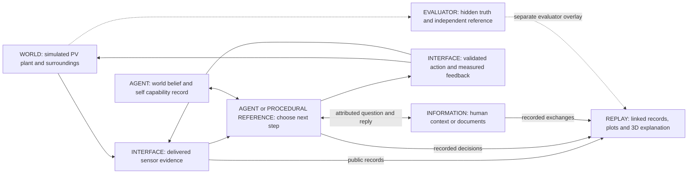

# Workflow visualization: explain the PV decision process

Version 1, 19 October 2026. Required companion to the
[interactive prototype plan v2](interactive-pv-prototype-v2.md), following Wei's
request for plots and 3D views that explain how the agentic system works and why
its workflow might improve PV operation. This is a development specification,
not a claim that an adaptive viewer or agent has been implemented.

## Questions every demonstration should answer

1. What changed in the external WORLD?
2. What evidence was actually available to the AGENT at this moment?
3. What did it record as its explanation or information gap?
4. Why did it choose a measurement, experiment, question, wait or finish?
5. Which tool/skill executed the choice, and did the requested action occur?
6. What fresh observation supported or contradicted its expectation?
7. How did its next decision differ from the procedural reference, and did that help?

The last question may have a null or negative answer. The viewer must explain
unsupported claims, failed actions and unnecessary questions as clearly as successes.

## Role and capability map

This is the planned integrated arrangement. The simulator, public interface and
recorded-information components exist; adaptive reasoning and the synchronized
viewer are proposed. In the delivered viewer, a compact version of this map
highlights the currently selected event and its real data source.

The reference uses its frozen procedure state in place of adaptive belief updates.
The map's arrows describe data/command flow; they are not physical wiring or proof
that every component has been implemented.

## Synchronized views

Use one replay cursor linked to original event IDs. A selected event highlights
the corresponding evidence, decision, command, measured response and cost in all
views. Seeking must rebuild state from records rather than carry later beliefs
back into earlier moments.

| View | Required content | Purpose |
|---|---|---|
| Workflow timeline | WORLD event, SENSOR capture/delivery/availability, AGENT decision, INFORMATION request/reply, ACTUATOR command/application/confirmation, VERIFICATION. | Make the full loop and delays visible. |
| Decision/evidence panel | Recorded concise rationale, evidence references, information gap, considered alternatives if recorded, prediction, selected tool and subsequent update. | Explain the decision from evidence, rather than merely show an action label. |
| Engineering plots | Delivered V/I/P, reference irradiance, temperature, requested and measured voltage, budgets; prediction windows and actual residuals where recorded. | Connect a decision to measurable consequences. |
| Spatial 3D replay | Panel, reference sensor, camera/rail, reachable poses and actual or estimated camera motion, source direction and view-only obstructions. | Explain where sensing/action occurs and how viewpoint affects available evidence. |
| Original camera view | Unmodified retained RGB plus capture/exposure/delivery/availability times and validity. | Show exactly what visual evidence existed. |
| R/A comparison | Matched procedural/adaptive timelines, decision points, raw costs and supported outcomes. | Explain the operational difference and whether it was useful. |

First deliverable: a local replay viewer with play/pause, scrub, step-by-decision,
orbit/reset for 3D, and selectable evidence references, plus static figures for
PDF reports. The viewer is a presentation of recorded episodes; it does not run
a second physical model or execute control commands. A narrated video can be a
later export from the same replay, not a separate hand-authored evidence source.

Public power is a derived quantity: calculate P = V × I only from valid voltage
and current samples with matching capture times, available by the displayed
decision time. Retain both sample references and the derivation rule. Missing or
unmatched pairs remain gaps; private true power is a separate evaluator trace.

## Spatial view and truthful presentation

Derive geometry, units, object identities and coordinate transforms from the
recorded scene/configuration and its version, not an invented attractive panel.
Reuse the existing panel/camera setup. Keep the original agent RGB image separate
from the orbitable explanatory view: an orbit view is not a sensor observation.

For an agent-perspective reconstruction, use public nominal geometry and delivered
encoder estimates, labelled with their time and uncertainty/validity. When private
actual pose/state is available, show it only in a separately labelled evaluator
reconstruction. Do not silently replace a delayed/noisy encoder estimate with truth.
Requested camera pose and actual/estimated movement must be distinguishable.

The current public task contains nominal camera calibration, not a complete public
scene manifest. Freeze and label any additional permitted prior geometry in D1.
Unknown geometry stays unknown in agent-perspective reconstruction; do not obtain
it by copying the private configuration into a public viewer payload.

Symbolic arrows may show source direction, observation or command links. Label
them as explanations; they are not measured rays or evidence of geometric source
shadows. Electrical probes are shown as load commands and measured plots, not
as fictional mechanical movement. Temperature colors, if useful, require a
legend and an explicit data source; they are not thermal-camera imagery.

Only implemented physical behavior is animated. Existing view-only screens must
not cast a fictional electrically effective shadow. Do not show cleaning, panel
tilt, moving maintenance robots or electrical reconfiguration as current tools.
Interpolation between recorded spatial samples is labelled as presentation
interpolation, not a new capture or proof of unrecorded motion.

## WORLD, AGENT and EVALUATOR information boundaries

Use stable text labels and line/shape styles in addition to color. Separate:

- **World/evaluator explanation:** what actually changed, private state and
  independent references. A teaching overlay, unavailable to the policy.
- **Agent knowledge at time t:** only public evidence returned by that decision
  time, permitted prior information and its recorded summaries/updates.
- **Action state:** proposed/requested, accepted, physically applied, then measured
  confirmation or failure. An acknowledgement is not successful application.
- **Future design:** clearly labelled illustrative material, never mixed into a
  measured adaptive run without a visible status change.

A public/agent export must contain no private payload, not merely hide it with
a UI toggle. An evaluator export may contain both streams with explicit labels,
but it is not an agent input or public-only artifact. The view toggle changes what
a human reviewer sees; it does not grant the policy additional knowledge.

Show decisions as recorded structured summaries, not reconstructed private
thought processes. Empty predictions remain empty. B1 checks image presence but
does not interpret pixels; a retained B1 demonstration must say so. Explanatory
captions created for a report are labelled commentary and linked to their sources.

## Time and event contract

The viewer consumes a versioned read-only presentation index referencing original
artifacts. It must not require incompatible changes to accepted raw records.
Minimum proposed fields are:

- Episode, policy/version, event ID/type, record reference and source hash.
- Visibility class: public, private evaluator, or explanatory annotation.
- Simulation time; capture/exposure, delivery and agent-availability time where
  applicable; wall timestamps and waiting duration separately.
- Observation/action/request/decision IDs and causal-attribution links.
- Payload reference, units, validity, recorded prediction and verification window.
- Spatial configuration reference and pose source: public estimate or private truth.

Attribution links record what the policy used; they are not automatically proof
of physical causation. Order events by their declared time and stable sequence;
do not invent an order for ties. If an older format lacks a needed field, mark it
unknown or derive it with an explicit rule and provenance.

Default plots show measurements only once available to the policy. An optional
capture-time plot may show acquisition timing, but is labelled accordingly and
does not imply early availability. Private continuous truth uses a different
style in evaluator mode. Original camera frames appear no earlier than their
recorded availability, retaining stale/drop/late status.

During an external wait, show a stationary simulation clock and a separate wall
timer. Do not animate physics, acquire frames or accrue PV energy through paused
wall time. A compressed display must disclose compression. Responses and belief
updates appear when recorded; predictions are placed before their verification
window rather than added retrospectively.

## How to show why the workflow matters

Use one short episode story and its matched reference:

| Story beat | Visual explanation | Evidence needed |
|---|---|---|
| Change | Evaluator shows the disturbance; agent panel remains limited to available observations. | Hidden event and public acquisition/delivery records. |
| Notice | Highlight the measurements supporting an agent-recorded discrepancy. | Actual decision summary; do not invent a detector for B1. |
| Choose | Show the chosen tool, stated gap and recorded alternatives when available. | Pre-action decision; no invented choice tree. |
| Investigate | Show a probe, camera move or attributed question/reply while costs accumulate correctly. | Commands, actual measurements or recorded exchange. |
| Check | Compare the committed prediction and fresh outcome; show revision or unresolved status. | Prediction timestamp, measurement and update. |
| Compare | Show where R and A followed different procedures and their verified outcomes/costs. | Two matched executed runs, not an animated hypothetical baseline. |

The source-step story should allow A to conclude that local sensing suffices.
A separate context case can demonstrate a useful follow-up only after D1 defines
a legitimate decision that depends on that context. Do not claim a web/human
benefit merely because a request appears in the workflow.

Use absolute simulation time for paired plots on a common horizon. A secondary
step-aligned teaching view may compare decision sequences of different lengths,
but must retain each policy's timestamps and state that spacing is not elapsed
time. Energy/cost comparisons always use the frozen experiment definition.

## Visualization acceptance tests

| ID | Check | Failure it must catch |
|---|---|---|
| V01 | Every plotted value, frame and decision links to the exact retained record/hash; image pixels preserved; derived power uses matched valid public V/I. | Fabricated/substituted evidence or private power presented as a public measurement. |
| V02 | Seek before/after capture, delivery and decision boundaries; include late/stale/dropped frames. | Future evidence or latest frame appearing early. |
| V03 | Command, applied state and fresh confirmation differ correctly in delayed/failed-action fixtures. | Drawing a target as achieved motion or voltage. |
| V04 | Prediction precedes outcome; unrecorded reasoning and predictions remain explicitly missing. | Post-hoc explanation presented as foresight. |
| V05 | Public export has no private fields/artifacts; evaluator overlays are labelled and separate. | A truth leak concealed only by a visibility toggle. |
| V06 | Pause/reply/retry traces preserve simulation time, wall time and costs; scrub is deterministic. | Energy during an information pause or duplicate query cost. |
| V07 | 3D transforms match known scene landmarks and pose sources; public geometry is explicitly permitted; original camera is distinguished from reconstruction. | Wrong axes/scale, invented motion or private geometry/pose as public knowledge. |
| V08 | Paired display preserves each episode's actions/timestamps; totals match the comparison evaluator. | False time alignment or a fabricated improvement. |
| V09 | Small end-to-end viewer fixture exercises load, seek, event selection and missing/invalid asset handling. | A visually plausible page with broken controls or silently ignored data errors. |
| V10 | Inspect the actual viewer and every exported report page/figure at intended size. | Clipped labels, illegible plots, hidden qualifications or color-only distinctions. |

Use meaningful existing delay/failure/source fixtures for these checks. A viewer
test can pass using a labelled recorded procedural trace; an adaptive-workflow
claim additionally requires an actual A episode. A live-channel claim additionally
requires real live provenance, not a URL displayed beside simulated text.

## Delivery sequence

1. Freeze D2's event mapping and build a single retained B1 replay with synchronized
   original camera, spatial reconstruction, timeline and plots. Mark it procedural.
2. Connect the same viewer to a complete recorded-source A episode and matched R
   episode; add decision summaries and the comparison view without hand-editing runs.
3. Export the paired explanatory figures/3D snapshots to the next evidence report;
   retain all failures and limitations. Demonstrate actual human/web flows separately.
4. Add memory retrieval/applicability panels only when D6 supplies actual records.

Viewer geometry, derived data, scripts and dependencies need version/hash records.
Choose implementation libraries after checking the local environment; this plan
does not prescribe a new framework or authorize an unnecessary installation.
